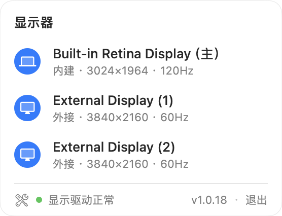
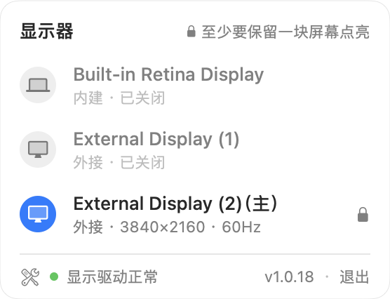

# DisplaySwitch · 显示器开关

<p align="center"></p>

<p align="center">macOS 菜单栏小工具：<b>在软件层面断开 / 重连任意一块显示器</b>，并保证你不会被困在全黑里。<br>
A macOS menu bar app that virtually disconnects any display — and never leaves you stuck on a black screen. <a href="#english">English</a></p>

<p align="center">


</p>

## 为什么做这个

接拓展坞办公时，我习惯关掉笔记本自带的屏、只用外接屏；拔坞走人时，又要它立刻亮回来。
BetterDisplay 的「断开 / 重连」能做到前一半，但功能繁多、要付费，而后一半——**拔坞那一刻**——
恰恰是最容易出事的：内建屏是被软件关掉的，外接屏又被物理拔走，一块亮着的屏都不剩，只能强制重启。

DisplaySwitch 只做这一件事，但把它做到不会出事：开关任意一块屏，并用两层保护确保无论你怎么拔线、合盖、
让屏幕睡眠，都能回到看得见的状态（见[安全模型](#安全模型为何不会把你卡死在全黑)）。零依赖、零配置、不付费。

> 「关闭」= **虚拟断开**：macOS 会以为这块屏被拔掉了（从活跃列表消失、窗口自动迁到别的屏、菜单栏 / Dock 重排），
> 「打开」再让它干净地回来。**不是**熄背光，**不是**镜像。

## 功能

- 点菜单栏图标弹出面板，**每块屏一张卡片**（含内建屏）：内建 / 外接、分辨率与刷新率。
- **点整行就开 / 关**，没有小开关要瞄准：开着的屏行首是彩色实心圆，关着的变灰并写「已关闭」。
- **只剩最后一块亮着时，顶部直接写原因**：「至少要保留一块屏幕点亮」，被锁的那行带一把小锁；再点它，锁和提示会抖一下。
- 底部状态栏写着**显示驱动是否正常**：macOS 27.0 的雷雳显示驱动会卡死（卡死时拔坞会留下残影屏，严重时内核崩溃），这里能提前看到——绿点正常，橙点卡死或有残影屏。
- 点它是**开发者工具**：驱动检查的依据、全黑救援的状态与上次触发时间、打开救援日志、复制诊断信息，平时不占面板地方。
- 显示名 = 系统名 + 稳定编号 +（主）。同型号多块屏按 UUID 编号 `(1)(2)`，关、开、挪位置都不会串号。
- 退出 app → **所有被关的屏自动恢复**。

## 支持的场景

除特别注明外，都在真机上按真实动线验证过（Apple Silicon · macOS 27）：

| 场景 | 会发生什么 |
| --- | --- |
| 关掉内建屏用外接屏，**拔掉雷雳拓展坞**（开着盖） | 拔线后一两秒内，内建屏自动亮回 |
| 外接屏走**机身 HDMI 口**，拔掉 HDMI（开着盖） | 拔出后约 40 毫秒内建屏亮回（v1.0.16 起） |
| **合着盖**拔坞走人，到别处开盖 | 开盖那一刻内建屏亮回 |
| **屏幕睡眠时**拔线，回来按一下键 | 唤醒那一刻内建屏亮回，不会卡住菜单栏（v1.0.15 起） |
| 被关掉的外接屏拔走，之后再插回来 | 面板里照样列出它，点一下就能打开 |
| app 崩溃或被强杀，屏还关着 | 重新打开 app 会自动点亮遗留的关闭屏；重启电脑也一样恢复 |
| 没有内建屏的台式机（Mac mini 等） | 最后一块亮着的屏被锁住，不能关（由单元测试覆盖，尚未在台式机真机上验证） |

**已知的系统问题（不是本 app 引起的）**：macOS 27.0 的雷雳显示驱动偶尔会卡住，之后拔坞可能留下「残影屏」
（屏已拔掉，系统仍当它在线，窗口困在上面）。这时可以在面板里把残影屏关掉，窗口就会回到内建屏；
拔坞前跑一次 `bash scripts/selfcheck.sh`，「物理外接屏数 ≥ 活跃外接屏数」一项报红即说明驱动卡了，先重启再拔。

## 工作原理

| 要做的事 | 用什么 | 为什么是它 |
| --- | --- | --- |
| 断开 / 重连一块屏 | 私有接口 `CGSConfigureDisplayEnabled`，配置范围 `.forAppOnly` | 公开 API 没有「虚拟断开」；**绝不**用 `.permanently` |
| 知道线被拔了 | IOKit 显示传输节点的**销毁**与**重新登记**通知 | 拔线瞬间内核直接推送，零轮询；机身 HDMI 口的节点常驻，只能靠后者 |
| 判断物理上还连着几块屏 | 数带 EDID 的显示传输节点 | 与拔线通知同步归零；CoreGraphics 的活跃屏列表此刻还是旧的 |
| 判断合盖、屏幕睡眠 | `AppleClamshellState`、`CGDisplayIsAsleep` | 这两种时刻点亮注定失败，要等开盖 / 唤醒再做 |
| 找回上次遗留的关闭屏 | 私有接口 `CGSGetDisplayList` | 唯一能列出「被禁用的屏」的接口 |

## 安全模型（为何不会把你卡死在全黑）

核心规则：**绝不把你置于「无法恢复的全黑」**。这需要两层，缺一不可——
第一层管「按下开关那一刻」，第二层管「那之后世界变了」。

### 第一层：关屏前的静态校验

- 关掉后仍剩 ≥1 块亮着的屏 → 允许；
- 关掉后会全黑 → 只有存在**可开盖恢复的内建屏**兜底才允许：
  - **笔记本**（合着盖也算）→ 允许关到全黑，**开盖即恢复内建屏**;
  - **没有内建屏的台式机** → 必须留 ≥1 块亮着的屏。
- **防死锁**：内建屏被本 app 关掉后就不算兜底；也不允许把内建屏自己关成全黑。

### 第二层：全黑自动救援

静态校验默认「作兜底的那块屏会一直在」。现实会打破这个前提：关掉内建屏用外接屏，然后拔掉拓展坞——
兜底的屏被物理拔走，而系统仍记着被关掉的内建屏（实测：断开状态不会因拔线回滚）→ 全黑。
这时你连菜单栏都点不到，所以救援不能等你操作。

app 监听拔线的内核事件，一旦「一块能亮的屏都不剩、而本 app 还关着屏」，就立刻把关掉的屏开回来（失败会有界重试）。
两种时刻点亮注定失败，就不硬试、等下一个时机：只剩内建屏能救而盖子合着 → 等开盖；
屏幕在睡眠（系统此刻不处理显示配置，硬试会空等约 10 秒）→ 等唤醒。

> 判据与触发源**都不用 CoreGraphics**，这是实测逼出来的：拔线时它的重配置回调全程 0 次派发，
> 活跃屏列表还报着拔线前的屏数。也**没有用定时轮询**：屏幕息屏时活跃屏数同样归零，
> 轮询分不清息屏和全黑，会在你息屏时擅自把你关掉的屏开回来。

救援过程写诊断日志到

`~/Library/Logs/DisplaySwitch.log`

——全黑时你看不到任何界面，万一救援失败，这是事后唯一能查清「通知到没到、判据是多少、连着哪些接口」的地方。
日志有上限（256 KB，约两年的记录），超过就只留最新的一半，不会无限占空间。

兜底恢复链：

- **退出 app** → 主动把所有被关的屏开回来（恢复是 app 做的，系统不会代劳——实测断开状态不绑定调用进程）。
- **崩溃 / 被强杀** → app 来不及恢复；重新打开 app 会自动点亮遗留的关闭屏。
- **永不开机自启**（硬约束）→ 断开状态只在 WindowServer 内存里、不落盘（实测），**重启**后必是「所有屏正常、app 未运行」。

## 系统要求

- **Apple Silicon** + **macOS 13+**（当前验证于 macOS 27.0，此前为 macOS 26.x）。
- 用到私有符号与 IOKit 内部结构，**系统大版本升级后请跑一次** `bash scripts/selfcheck.sh` 确认依赖完好；
  手边有外接屏时加 `--plug`，按提示拔一块屏，复验拔线通知。
- 非 Apple Silicon 或私有接口缺失时，app 自动**只读**并在面板顶部提示——绝不在未验证的平台上动显示器。

## 构建与安装

```bash
swift build && swift test        # 构建 + 跑测试
./scripts/package.sh             # 打包成 build/DisplaySwitch.app(ad-hoc 签名)
bash scripts/snapshots.sh        # 重新生成上面的面板截图(演示数据,不碰真实显示器)
```

把 `build/DisplaySwitch.app` 拖进「应用程序」即可。它常驻菜单栏（无 Dock 图标），启动后看屏幕右上角。

**分发给别人**：本地签名、未公证，首次打开会提示「无法验证开发者」。右键 App →「打开」，或：

```bash
xattr -dr com.apple.quarantine /Applications/DisplaySwitch.app
```

## 换机器后

项目记忆的单一源在仓库里（`.claude/memory/`，随 git 走）。clone 之后跑一次：

`bash scripts/link-memory`

它把记忆软链回 `~/.claude/projects/<本项目>/memory/`——那是本机目录、不随 clone 走。

## 说明

- 用到私有符号（经 `dlsym` 动态解析，无链接期硬依赖），因此**无法上架 App Store**，仅本地 / 自分发。
- 不关 SIP、不需特殊 entitlement、不申请任何权限。
- 设计细节与每条结论的实测记录见 [`docs/superpowers/specs/2026-06-18-display-switch-design.md`](docs/superpowers/specs/2026-06-18-display-switch-design.md)。
- 面板版式参考了 [MonitorBar](https://github.com/Binaryify/MonitorBar)（每屏一张卡片、底部状态栏）。

## English

DisplaySwitch lives in the macOS menu bar and **virtually disconnects or reconnects any display**, built-in included:
macOS behaves as if the cable were unplugged (windows move, the menu bar and Dock relocate), and the display
comes back cleanly when switched on again. It is not a backlight or mirroring trick.

The hard part is safety. Turn off the built-in screen, work on an external one, then unplug the dock — and nothing
is lit. DisplaySwitch prevents that in two layers: it refuses to turn off a screen when that would leave no
recoverable display, and it listens to kernel IOKit events so that the moment the last lit screen is unplugged it
turns the built-in screen back on — or waits for the lid to open or the display to wake when lighting it now would
fail. Verified on Apple Silicon with macOS 27 across Thunderbolt docks, the built-in HDMI port, closed lids and
sleeping displays. It never launches at login, so a restart always returns to a clean state.

Requires Apple Silicon and macOS 13+. Uses private APIs, so it cannot ship on the App Store; after a major macOS
update, run `bash scripts/selfcheck.sh`. Build with `swift build`, package with `./scripts/package.sh`.
